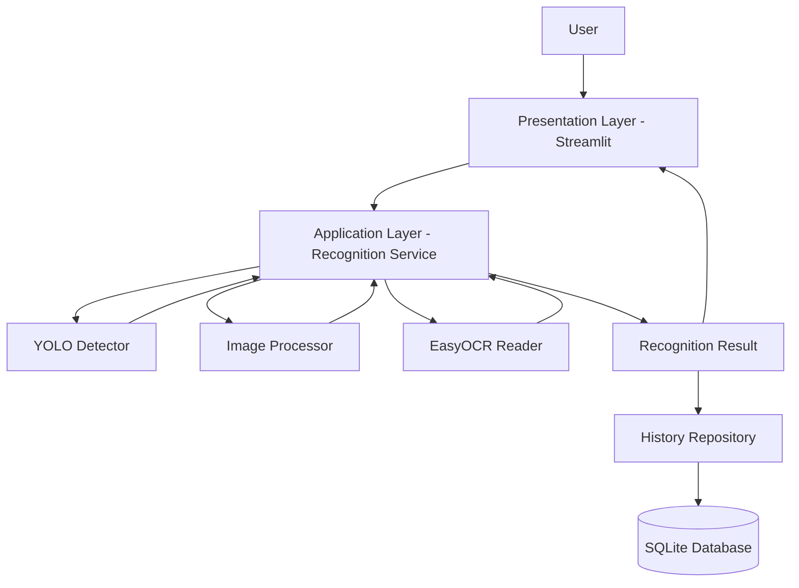

# License Plate Recognition System (ALPR)

**Hệ thống nhận dạng biển số xe tự động sử dụng Python và Computer Vision**


---

## 1. Giới thiệu

License Plate Recognition System (ALPR) là phần mềm nhận dạng biển số xe tự động được xây dựng bằng Python, ứng dụng Computer Vision và Optical Character Recognition (OCR).

Hệ thống thực hiện quá trình phát hiện vị trí biển số, trích xuất vùng ảnh và nhận dạng các ký tự trên biển số phương tiện.

Dự án được phát triển trong khuôn khổ bài tập lớn tại trường đại học, với mục tiêu xây dựng một ứng dụng nhận dạng biển số xe có giao diện trực quan, khả năng xử lý ảnh và lưu trữ lịch sử nhận dạng.

### Mục tiêu

- Phát hiện biển số xe từ hình ảnh.
- Nhận dạng ký tự trên biển số.
- Hỗ trợ xử lý hình ảnh và video.
- Hiển thị kết quả nhận dạng trực quan.
- Lưu trữ và tra cứu lịch sử nhận dạng.
- Thiết kế hệ thống theo kiến trúc module, dễ mở rộng và bảo trì.

## 2. Tính năng

### Core Features

| Chức năng | Mô tả | Trạng thái |
|---|---|---|
| Image Input | Tải ảnh từ máy tính | Planned |
| License Plate Detection | Phát hiện vị trí biển số bằng YOLO | Planned |
| Image Processing | Cắt và tiền xử lý ảnh biển số | Planned |
| Character Recognition | Nhận dạng ký tự bằng EasyOCR | Planned |
| Result Visualization | Hiển thị kết quả nhận dạng | Planned |
| Recognition History | Lưu lịch sử bằng SQLite | Planned |
| Video Recognition | Nhận dạng biển số từ video | Planned |
| Live Camera | Nhận dạng qua webcam | Planned |

## 3. Công nghệ sử dụng

| Công nghệ | Vai trò |
|---|---|
| Python 3.11 | Ngôn ngữ lập trình |
| OpenCV | Xử lý hình ảnh và video |
| Ultralytics YOLO | Phát hiện biển số |
| EasyOCR | Nhận dạng ký tự |
| NumPy | Xử lý dữ liệu hình ảnh |
| Streamlit | Xây dựng giao diện |
| SQLite | Lưu trữ dữ liệu |
| Git / GitHub | Quản lý mã nguồn |

### Recognition Pipeline

Hệ thống sử dụng quy trình nhận dạng gồm hai thành phần AI chính:

**1. Object Detection – YOLO**

Phát hiện vị trí biển số trên hình ảnh và trả về bounding box.

**2. Optical Character Recognition – EasyOCR**

Nhận ảnh biển số đã được trích xuất và chuyển các ký tự trong ảnh thành văn bản.

## 4. System Architecture

Dự án sử dụng kiến trúc **Modular Monolith**, chia hệ thống thành các module có trách nhiệm độc lập.



### Các nguyên tắc kiến trúc

- UI không trực tiếp xử lý thuật toán AI.
- Service chịu trách nhiệm điều phối quy trình nhận dạng.
- Core chứa các thành phần xử lý Computer Vision.
- Repository chịu trách nhiệm truy xuất dữ liệu.
- Các module giao tiếp thông qua interface và cấu trúc dữ liệu thống nhất.
- Mô hình AI được khởi tạo một lần và tái sử dụng.

## 5. Project Structure

```text
license_plate_recognition/
│
├── app.py
├── requirements.txt
├── README.md
├── .gitignore
│
├── src/
│   ├── __init__.py
│   │
│   ├── config/
│   │   ├── __init__.py
│   │   └── settings.py
│   │
│   ├── core/
│   │   ├── __init__.py
│   │   ├── detector.py
│   │   ├── image_processor.py
│   │   └── ocr.py
│   │
│   ├── services/
│   │   ├── __init__.py
│   │   └── recognition_service.py
│   │
│   ├── models/
│   │   ├── __init__.py
│   │   └── schemas.py
│   │
│   └── repositories/
│       ├── __init__.py
│       └── history_repository.py
│
├── ui/
│   ├── __init__.py
│   ├── pages/
│   └── components/
│
├── models/
│   └── license_plate_detector.pt
│
├── data/
│   ├── input/
│   └── output/
│
├── database/
│
└── tests/
```

### Module Responsibilities

| Module | Responsibility |
|---|---|
| `config` | Quản lý cấu hình hệ thống |
| `core/detector` | Phát hiện biển số bằng YOLO |
| `core/image_processor` | Cắt và tiền xử lý ảnh |
| `core/ocr` | Nhận dạng ký tự |
| `services` | Điều phối quy trình nhận dạng |
| `models` | Định nghĩa cấu trúc dữ liệu |
| `repositories` | Quản lý dữ liệu và lịch sử |
| `ui` | Giao diện người dùng |
| `tests` | Kiểm thử các module |

## 6. Installation

### Requirements

- Windows 10/11 hoặc Linux.
- Python 3.11.
- Git.
- VS Code hoặc IDE tương đương.

### Step 1: Clone repository

```bash
git clone <REPOSITORY_URL>
cd license_plate_recognition
```

### Step 2: Create virtual environment

Windows:

```powershell
py -3.11 -m venv .venv
.venv\Scripts\activate
```

Linux:

```bash
python3.11 -m venv .venv
source .venv/bin/activate
```

### Step 3: Install dependencies

```bash
python -m pip install --upgrade pip
pip install -r requirements.txt
```

### Step 4: Run application

```bash
streamlit run app.py
```

## 7. Model & Dataset

### Model

Hệ thống sử dụng mô hình YOLO được huấn luyện cho nhiệm vụ phát hiện biển số xe.

Model được lưu tại:

```text
models/license_plate_detector.pt
```

Không nhất thiết phải lưu file model lớn trực tiếp trong Git repository. Nhóm có thể chia sẻ model qua Google Drive hoặc Git LFS.

### Dataset

Dataset phục vụ kiểm thử và đánh giá được lưu trong:

```text
data/
├── input/
│   ├── images/
│   └── videos/
│
└── output/
    └── results/
```

Dataset cần bao gồm:

- Biển số xe máy.
- Biển số ô tô.
- Nhiều góc chụp và khoảng cách.
- Các điều kiện ánh sáng khác nhau.
- Ảnh biển số rõ và mờ.

## 8. Team & Responsibilities

Dự án được phát triển bởi nhóm 3 thành viên.

| Thành viên | Phụ trách | Module |
|---|---|---|
| Member 1 | Computer Vision & Detection | YOLO, OpenCV |
| Member 2 | OCR & Application Logic | EasyOCR, Recognition Service |
| Member 3 | UI & Data Management | Streamlit, SQLite |

### Development Workflow

Nhóm sử dụng Git để quản lý mã nguồn và phối hợp phát triển.

Quy tắc:

1. Mỗi thành viên làm việc trên branch riêng.
2. Không commit trực tiếp lên `main`.
3. Mỗi module cần có kiểm thử.
4. Sử dụng Pull Request để tích hợp code.
5. Không tự ý thay đổi interface giữa các module.

## 9. Testing & Evaluation

Hệ thống được đánh giá thông qua các tiêu chí:

| Metric | Ý nghĩa |
|---|---|
| Precision | Tỷ lệ phát hiện đúng trong các dự đoán |
| Recall | Tỷ lệ phát hiện được trong các biển số thực tế |
| mAP | Đánh giá hiệu quả Object Detection |
| Character Accuracy | Độ chính xác nhận dạng ký tự |
| Exact Plate Accuracy | Tỷ lệ nhận dạng chính xác toàn bộ biển số |
| Processing Time | Thời gian xử lý trung bình |

## 10. Development Roadmap

- [ ] Phase 1: Project Setup & Environment
- [ ] Phase 2: License Plate Detection
- [ ] Phase 3: Image Processing
- [ ] Phase 4: OCR Recognition
- [ ] Phase 5: Recognition Service Integration
- [ ] Phase 6: User Interface
- [ ] Phase 7: Database Integration
- [ ] Phase 8: Testing & Evaluation
- [ ] Phase 9: Documentation & Final Release

## 11. License

This project is developed for educational and academic purposes.

Model, dataset and third-party libraries remain subject to their respective licenses and usage terms.

---

**Project:** License Plate Recognition System  
**Version:** 1.0.0  
**Status:** In Development
